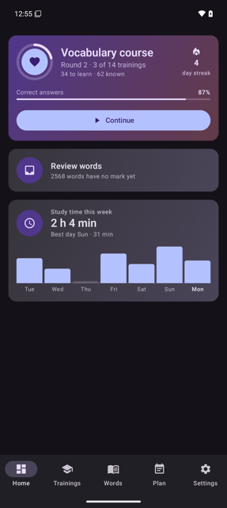
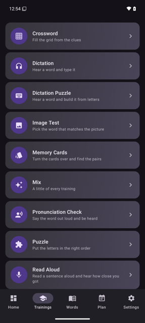
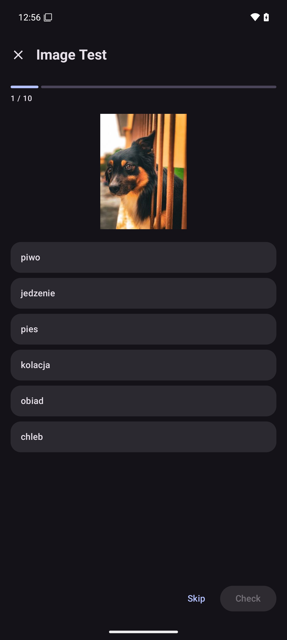
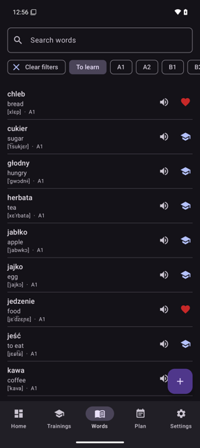
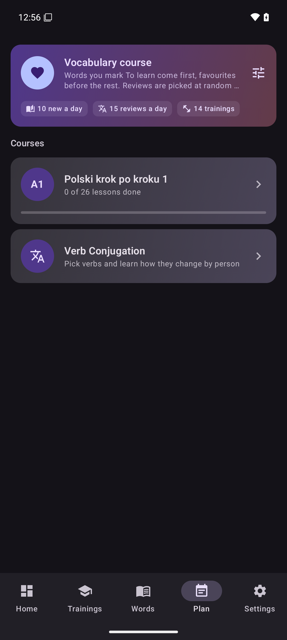
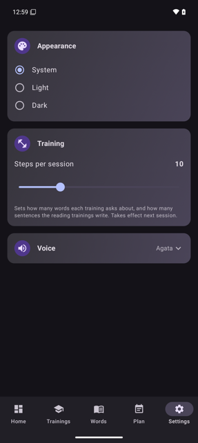
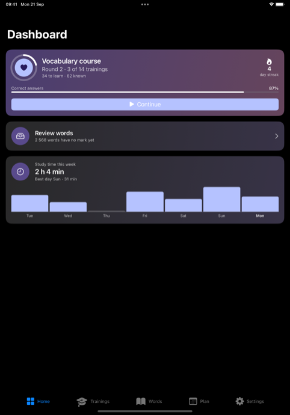

# Lexicon

An app for learning Polish, on Android and iOS, built for one learner and shaped around
how the learning actually goes: you choose the words you want to know, practise them
through a range of trainings, and a review schedule decides what comes back and when.

## What it does

**Words you mark.** The app ships with 2,664 Polish words graded A1 to C2, grouped into
74 presets across 11 categories by topic and frequency — among them 164 false friends that
look like an English or Russian word and mean something else. Every word carries a status
you change with one tap: to learn, favourite or known. *Review words* deals out the ones
with no status yet, one card at a time. You can add words of your own; the IPA
transcription and the CEFR level are worked out for you, and translations are suggested
as you type.

**Every word in a sentence.** 2,612 of the words and 4,464 of the verbs ship with an
example showing the word in use, the word itself in bold and a button that reads the
sentence aloud. You can rewrite one, or ask for another.

**Fifteen ways to practise.** Dictation, Dictation Puzzle, Puzzle, Image Test, Word Match,
True or False, Pronunciation Check, Read Aloud, Memory Cards, Crossword, Word Card, Read
and Write, Read and Choose, Word Search, and a Mix that shuffles them together. Some read
a word aloud and ask you to type it; some show a picture; some listen to you say it.

**Spaced repetition underneath.** Every answer is graded, and a word's first answer of the
day feeds an SM-2 schedule, so a word you know comes back in three weeks and a word you miss
comes back tomorrow, and the vocabulary course reviews the known words whose turn has come.
Study days, streaks and accuracy are recorded as you go.

**A course on the dashboard.** The *vocabulary course* is on the dashboard from the first
launch: the words you mark to learn, favourites first, plus the known words that are due for
review, through a queue of trainings that repeats round after round. A word you are learning
becomes known once its review interval reaches three weeks. The home card counts the known
words that are due. You tune it on the Plan tab. A *course* teaches a fixed body of material — *Polish for Beginners*, built from a printed
A1 coursebook, with its own audio and exercises. A *conjugation course* drills the forms of
verbs you pick from a catalogue of 4,545. A *numbers course* drills writing numbers in
Polish words: you type the numbers and ranges to practise (`1-20, 35, 2024`), and each one
is shown in digits, read aloud on demand, and answered in words, with its transcription
after the check. A *countries course* drills the 197 states of the official Polish list:
you tick the countries to practise, and each is shown as a flag and its English name and
answered in Polish, with the country, the word for a man and a woman from it, and the
capital.

**Written and spoken by machine where it helps.** Example sentences, and the passages the
reading trainings use, are written by OpenAI around the word being practised. Translation
looks in the shipped vocabulary first and asks Google Cloud Translation for whatever is not
there. Speech is synthesised through Google Cloud Text-to-Speech, with the device's own
engine as a fallback, and pronunciation is judged by Google Cloud Speech-to-Text. Pictures
come from Pexels, Pixabay, Unsplash and Openverse.

## Screenshots

**Android**

| | | |
| :---: | :---: | :---: |
|  |  |  |
| **Home** — the vocabulary course, words waiting for a mark, and the week's study time | **Trainings** — fifteen ways to practise | **Image Test** — pick the word the picture is of |
|  |  |  |
| **Words** — every word with its status: to learn, favourite or known | **Plan** — the vocabulary course's settings, and courses to follow | **Settings** — theme, session length, and the voice you hear |

**iOS**

The same app on iPhone and iPad, in SwiftUI over the same shared core — the use cases,
the database and the review schedule are the identical Kotlin. All fifteen trainings and
the conjugation course are here too; what is not yet is listed in
[ios/README.md](ios/README.md).



## Tech stack

| | |
| --- | --- |
| Language | Kotlin 2.1, Kotlin Multiplatform for the shared modules |
| UI | Jetpack Compose, Material 3, Navigation Compose |
| Persistence | Room 2.7 over SQLite, DataStore for preferences |
| Injection | Koin 4 |
| Networking | Retrofit 2 and OkHttp 4, kotlinx.serialization |
| Images | Coil |
| Speech | Google Cloud Text-to-Speech and Speech-to-Text, Android TTS and SpeechRecognizer as fallbacks |
| Language model | OpenAI, for example sentences and reading passages |
| Translation | Google Cloud Translation, behind the shipped vocabulary |
| Testing | JUnit 4, MockK, Turbine; Compose UI test and Espresso 3.7 for the end-to-end suite |
| Static analysis | ktlint, detekt, Android Lint |
| Build | Gradle 8.12 with version catalogs, AGP 8.7 |
| Targets | Android 8.0 and up (minSdk 26, target 35); iPhone and iPad on iOS 17, linking the same shared framework — all fifteen trainings on both |

## Layout

Ten Gradle modules, layered so the domain depends on nothing:

```
model          the domain — pure Kotlin, no framework of any kind
   ^      ^
boundary   interactors        ports        use-case contracts
   ^   ^        ^
data android  application     adapters     use-case implementations
                  ^
             presentation
                  ^
                 app          composition root and navigation
```

[docs/architecture.md](docs/architecture.md) explains the rules and where to find things.

## Building

```
./gradlew check          # tests and static analysis: the everyday check, about 2 minutes
./gradlew build          # check, plus release APKs and every iOS framework
./gradlew :app:installDebug
```

Requires JDK 17. The app builds and runs without any keys — the features that need them
degrade rather than fail — but to have all of them, put these in `local.properties`,
which is not tracked:

```
openai.apiKey=...
google.ttsApiKey=...
google.translateApiKey=...   # optional; falls back to google.ttsApiKey
pexels.apiKey=...
pixabay.apiKey=...
unsplash.accessKey=...
openverse.clientId=...
openverse.clientSecret=...
```

Firebase is optional: drop in `google-services.json` and Crashlytics is wired up, leave it
out and the build skips those plugins.

## Data

Shipped catalogues live in `data/src/androidMain/assets` and are seeded into the database
on first launch and after an app update. Each is fingerprinted, so an unchanged asset
costs a file read and no parse.

The schema takes Room's destructive fallback rather than migrations — the project is
pre-release, so a version bump drops the database and re-seeds it, taking word statuses and
history with it. That makes a bump a deliberate act.

The countries course's names, nationalities and capitals come from the official list
*Urzędowy wykaz nazw państw i terytoriów niesamodzielnych*, 8th edition (2025), published
by the Komisja Standaryzacji Nazw Geograficznych poza Granicami Rzeczypospolitej Polskiej
(KSNG): <https://www.gov.pl/web/ksng/Urzedowy-wykaz-nazw-panstw-i-terytoriow-niesamodzielnych>.

## Documentation

| | |
| --- | --- |
| [Architecture](docs/architecture.md) | Modules, layering rules, where things live, conventions |
| [Universal DDD Language](docs/domain/universal-ddd-language.md) | The vocabulary: contexts, entities, aggregates, services |
| [Vocabulary and presets](docs/vocabulary-presets.md) | How the catalogue, presets and the study set work |
| [Course](docs/course.md) | The Polish for Beginners course: lessons, audio, exercises |
| [Numbers](docs/numbers.md) | The numbers course: choosing numbers, the words, transcriptions, progress |
| [Countries](docs/countries.md) | The countries course: choosing countries, accepted answers, progress, the data and its source |

## Status

Pre-release, version 0.1.0. 665 Kotlin files and 48 Swift files. 137 unit-test files,
seven instrumented tests over real SQLite, and five end-to-end tests driving the app.
